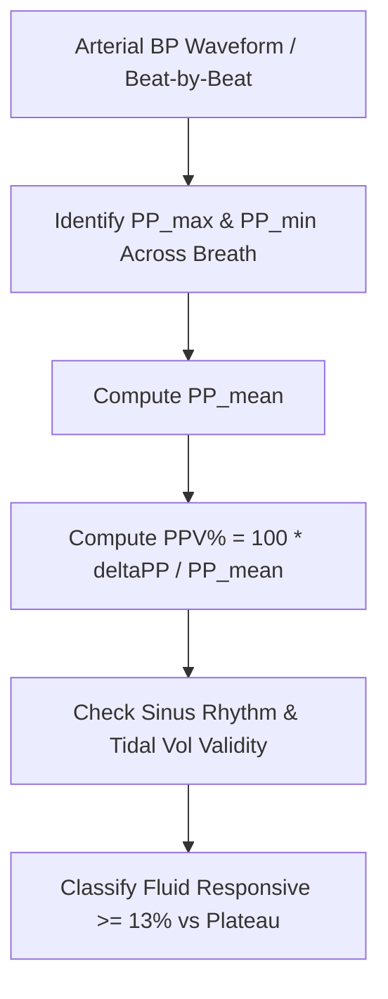

# Cardiac Pulse Pressure Variation (PPV) Personal Agent Skill

[](LICENSE)
[](https://www.python.org/)
[]()
[]()
[]()

Deterministic, zero-mock personal agent micro-skill for calculating Pulse Pressure Variation (PPV%) and Stroke Volume Variation (SVV%) to evaluate dynamic heart-lung interactions and predict fluid responsiveness under mechanical ventilation.

## Architecture



## Quickstart

```python
from client import PulsePressureVariationClient

client = PulsePressureVariationClient()
result = client.evaluate_respiratory_variations(
    sbp_max_mmhg=125.0,
    dbp_max_mmhg=65.0,
    sbp_min_mmhg=105.0,
    dbp_min_mmhg=70.0,
    sv_max_ml=68.0,
    sv_min_ml=46.0,
    tidal_volume_ml_kg_pbw=8.5
)
print(result)
```

## License

Apache-2.0
